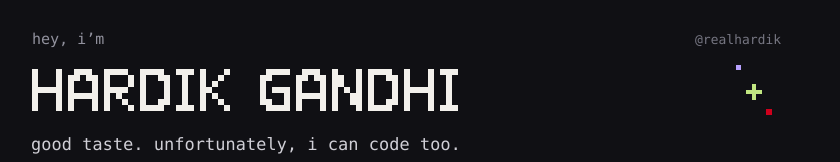
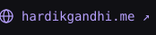
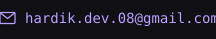
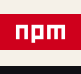
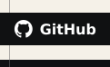
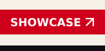

<!-- Slice filenames include a content hash so updated geometry does not reuse stale cached images. -->
<!-- Picture wrappers prevent GitHub from linking decorative images. -->
<!-- Keep each image strip at full height: GitHub line-height creates seams between thin rows. -->
<!-- GitHub removes link targets; target="_blank" applies only in renderers that preserve it. -->

  <picture></picture> <picture></picture><picture></picture><picture></picture> <picture></picture>

  <picture></picture> <picture></picture><picture></picture><picture></picture><picture></picture>

  <picture></picture>

<!-- Next project: replace the final image with another linked project card. -->
