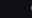
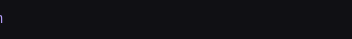
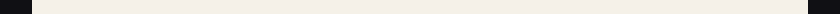
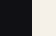
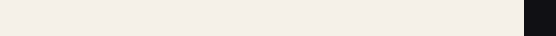
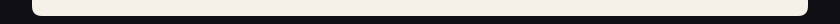

<!-- GitHub strips inline CSS and link targets. Picture wrappers prevent automatic image links. -->

  <picture></picture> <picture></picture> <picture></picture><picture></picture><picture></picture> <picture></picture> <picture></picture>

  <picture></picture> <picture></picture> <picture></picture><picture></picture><picture></picture> <picture></picture>

  <picture></picture>

<!-- Next project: replace the final image with another linked project card. -->
